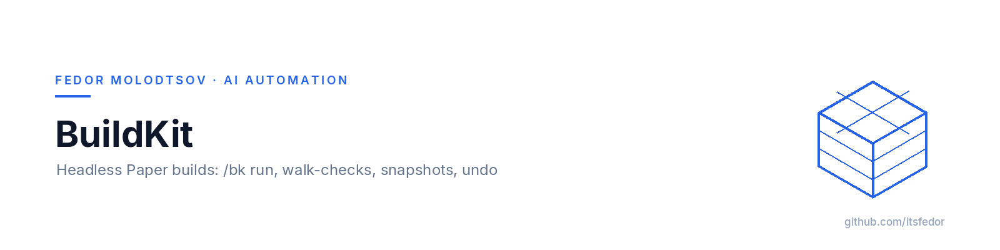
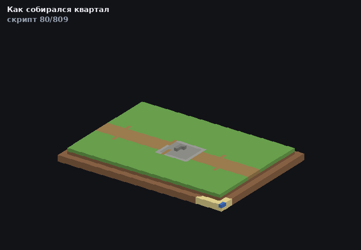

<picture>
  <source media="(prefers-color-scheme: dark)" srcset="assets/banner-dark.png">
  
</picture>

<p align="center"><sub><b>Fedor Molodtsov</b> — AI automation engineer · <a href="https://github.com/itsfedor">github.com/itsfedor</a></sub></p>

# BuildKit

[](#requirements)
[](#requirements)
[](#build)
[](LICENSE)

A Paper plugin that turns "build this district on the server" into something an agent can
run headlessly: one console command `/bk`, no WorldEdit, no `//`-commands, no Gradle.

Structures with rotation and mirroring, batch scripts with a tick budget, grid placement,
walk-ability checks, snapshots and undo — everything a build needs when the operator is a
script and the only feedback channel is `server.log`.



*The clip is generated from the world files by [mc-render](https://github.com/itsfedor/mc-render):
the first frames replay `city.bk` command by command (ground, street, plaza), then the six
houses are added in the order they were placed on the live server.*

## Why it exists

The server is an English-teaching world: a village quarter of six houses has to be rebuilt
and re-verified after every layout change, and every block has to match the NBT structure
exactly — a door rotated the wrong way or a bed missing a `part` property breaks a quest.

Doing that by hand in game is slow and not reproducible. BuildKit makes a build a *file*:
a `.bk` script is the diff, `verify.py` compares the world to the structure block by block,
`walkcheck` proves every door is reachable, and `undo` rolls the whole attempt back.

## Commands

| Command | What it does |
|---|---|
| `/bk save <name> <x1 y1 z1> <x2 y2 z2>` | capture an area into `structures/<name>.bk` |
| `/bk place <name> <x y z> [rot=0\|90\|180\|270] [mirror=none\|x\|z]` | paste at a min-corner anchor; block states transformed by vanilla logic |
| `/bk grid <names> <x y z> <dx dz> <nx nz> [cycle\|seeded]` | nx×nz grid with variant rotation |
| `/bk run <file> [--tick-budget=N]` | execute a script from `scripts/`, N blocks per tick (default 20000) |
| `/bk walkcheck <x1 z1> <x2 z2> [y]` | BFS over columns: is every door actually reachable? |
| `/bk probe <x y z>` / `/bk box <x1 y1 z1> <x2 y2 z2>` | RLE column / sliced dump with a palette |
| `/bk snapshot <name> <x1 y1 z1> <x2 y2 z2>` / `/bk undo [n]` | named and automatic snapshots, rollback by operations |
| `/bk export <name> <x y z> <file>` | structure → a script of `setblock` commands |
| `/bk list` / `/bk info <name>` | library listing, sizes, palette, block counts |

Every destructive operation writes an automatic snapshot first, so `/bk undo 1|2|3` is always
available. `--force` bypasses foreign-region protection and logs the operator name and bbox.

## Verified on a live server

The quarter in the clip above was rebuilt from a 6-command layout script plus six `/place`
templates on Paper 26.1.2 and then verified against the source of truth:

| Check | Result |
|---|---|
| World vs structure, block by block (name + properties) | **3942 / 3942 = 100.00 %** |
| Door and route walkability (`/bk walkcheck`) | **8 / 8 passable** |
| Roof holes, street coverage, water level, paths from porches | **`qa.py` PASS** |

Full report and the exact numbers: [`docs/CASE-STUDY.md`](docs/CASE-STUDY.md).

## Build

No Gradle, no Maven. `paper-api.jar` ships inside your server's `libraries/`.

```bash
PAPER_API=/path/to/paper-api-26.1.2.jar \
LIB_DIR=/path/to/server/libraries \
  bash build.sh /path/to/server/plugins
```

- Set `ECJ=/path/to/ecj.jar` to compile with ECJ; without it the script uses `javac`.
- `bash build.sh` with no arguments drops the jar into `./build/plugins`.
- Source layout: `src/main/java/com/nous/buildkit/` (23 classes), resources in `src/main/resources/`.

## Requirements

Paper 26.1.2 (tested on `26.1.2-74-e4e17fc`), Java 21+. Permissions: `buildkit.use`,
`buildkit.place`, `buildkit.run`, `buildkit.undo` (all default to op).

## Docs

- [`docs/REFERENCE-RU.md`](docs/REFERENCE-RU.md) — full reference: rotation geometry, `.bk`
  structures, script syntax, limits, known limitations (in Russian, the working language of
  the practice).
- [`docs/CASE-STUDY.md`](docs/CASE-STUDY.md) — the quarter rebuild: what changed, how it was
  verified, what stayed open.

## License

MIT. Builds on Paper API; no Paper code is vendored.
